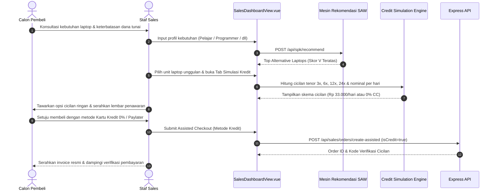

# Blueprint Implementasi Role Sales pada Sistem SmartLap
**Dokumen Perencanaan Arsitektur & Implementasi RBAC dengan Strategi Penjualan Berbasis Pembiayaan Kredit (Credit-Driven Sales)**  
*Sistem Pendukung Keputusan Pemilihan Laptop (Metode SAW) & Toko Elektronik*

---

## 1. Latar Belakang & Analisis Kebutuhan

Sistem **SmartLap** saat ini memiliki 2 entitas pengguna:
1. **Admin (Administrator Utama)**: Mengendalikan konfigurasi global sistem, bobot kriteria SAW ($C_1 - C_6$), manajemen produk laptop (CRUD, stok), audit transparansi matriks keputusan ($X, R, V$), serta analisis performa bisnis eksekutif.
2. **User / Tamu (Guest Customer)**: Pengguna publik yang memanfaatkan rekomendasi cerdas SPK SAW, menjelajahi katalog, melakukan *checkout* tanpa registrasi paksa, simulasi cicilan/pembayaran, dan pelacakan pesanan via nomor resi unik.

### Urgensi & Orientasi Bisnis Role `Sales` (Credit-Driven Sales Representative)
Dalam industri retail laptop dan elektronik modern, peran **Sales (Konsultan Penjualan & Pembiayaan)** memiliki mandat strategis:
- **Mendorong Pembayaran ke Skema Kredit/Cicilan (*Credit & Financing Push*)**:
  - Mengubah penolakan calon pembeli akibat harga tunai yang tinggi (*price resistance*) menjadi transaksi sukses melalui penawaran skema cicilan ringan (**Kartu Kredit 0%**, **Fintech Paylater**, dan **Kredit Konsumen Multifinance**).
  - Meningkatkan *Average Order Value* (AOV) dengan mengarahkan konsumen ke laptop spesifikasi lebih tinggi (rekomendasi SPK SAW skor terbaik) karena angsuran bulanan hanya berselisih sedikit.
  - Memperoleh insentif/komisi kemitraan pembiayaan per *closing* transaksi kredit.
- **Konsultasi Interaktif Berbantuan SPK & Simulasi Kredit**:
  - Mengoperasikan kalkulator kredit langsung di hadapan pembeli (POS/In-Store Assistance) dengan kalkulasi uang muka (DP), tenor 3 s/d 24 bulan, serta visualisasi komparasi biaya "Rp XX.000/hari" vs harga tunai jutaan rupiah.
  - Menghasilkan lembar simulasi penawaran cicilan resmi yang dapat dibagikan ke WhatsApp pelanggan atau dicetak.
- **Operasional & Fulfillment Transaksi**:
  - Mengelola pesanan masuk: memantau status persetujuan kredit (*credit verification/approval*), memperbarui status pengiriman (*pending* $\rightarrow$ *paid/approved* $\rightarrow$ *processing* $\rightarrow$ *shipped*), serta mencetak faktur resmi.
  - Memantau ketersediaan stok laptop *real-time* tanpa risiko menghapus data master.

---

## 2. Matriks Hak Akses (Role-Based Access Control / RBAC)

| Modul & Fitur Sistem | Admin | Sales | User / Publik | Otoritas & Peran Bisnis |
|---|:---:|:---:|:---:|---|
| **Rekomendasi SPK SAW** | ✅ Akses | ✅ Akses | ✅ Akses | Sales memanfaatkan SPK untuk merekomendasikan varian terbaik, lalu langsung menawarkan skema kreditnya. |
| **Katalog & Stok Laptop** | ✅ Full (C,R,U,D) | ⚠️ Read & Update Stok | ❌ Hanya Lihat | Sales dapat memperbarui mutasi stok fisik, tanpa izin menghapus produk master. |
| **Kalkulator & Simulasi Kredit** | ✅ Standar | 🌟 **Advanced Sales Tool** | ✅ Standar | Sales memiliki simulator khusus: perbandingan tenor, kalkulasi DP fleksibel, konversi biaya harian, dan cetak lembar penawaran. |
| **Assisted Checkout (Kredit Prioritas)** | ✅ Ya | 🌟 **Dedicated Mode** | ❌ Mandiri | Sales dapat membuatkan pesanan langsung atas nama konsumen dengan metode cicilan terpilih secara terpadu. |
| **Verifikasi Persetujuan Kredit** | ✅ Verifikasi | ✅ Verifikasi / Update | ❌ Cek Status | Sales memvalidasi bukti transaksi kredit/paylater atau input nomor kontrak pembiayaan. |
| **Kelola Profil & Bobot SAW** | ✅ Penuh | ❌ Tidak | ❌ Tidak | Otoritas khusus Admin/Kepala Toko agar model matematis tetap stabil. |
| **Audit Matriks SAW ($X, R, V$)** | ✅ Penuh | 👁️ Read-Only | ❌ Tidak | Sales dapat melihat transparansi perhitungan jika pembeli membutuhkan penjelasan akademis/logis. |
| **Manajemen Pesanan Masuk** | ✅ Full | ✅ Full Operasional | ❌ Hanya Resi Sendiri | Sales memproses pesanan, filter pesanan kredit vs tunai, cetak faktur & surat jalan. |
| **Dashboard Metrik Kinerja** | ✅ Eksekutif Finansial | 🌟 **Sales & Credit Metrics** | ❌ Tidak | Sales Dashboard menampilkan target bulanan, rasio konversi kredit (*credit adoption rate*), dan estimasi insentif. |

---

## 3. Fitur Khusus Sales: Pendorong Pembayaran Kredit (Credit Pitching Engine)

Untuk merealisasikan tujuan **mendorong transaksi kredit**, modul Sales dirancang memiliki sub-fitur unggulan:

### 3.1 Kalkulator Pembiayaan Komparatif (Comparative Credit Estimator)
- **Komparasi Skema Pembiayaan**:
  - *Kartu Kredit Cicilan 0%* (BCA, Mandiri, BRI, BNI) tenor 3, 6, 12, 24 bulan tanpa bunga.
  - *Paylater & Kredit Digital* (Kredivo, Akulaku, ShopeePayLater) bunga flat 2.6%/bulan tenor 1–12 bulan.
  - *Kredit Konsumen Multifinance* (Home Credit, FIF, AEON) dengan DP fleksibel 0%–30%.
- **Psikologi Angka (Daily Affordability Metric)**:
  - Mengonversi cicilan per bulan menjadi nominal harian:
    $$\text{Biaya Harian} = \frac{\text{Cicilan Bulanan}}{30}$$
    *Contoh:* Laptop Rp 12.000.000 dengan cicilan Rp 1.000.000/bulan ditampilkan sebagai **"Hanya setara Rp 33.300/hari (seharga 1 cangkir kopi)!"** untuk mempermudah sales melakukan *closing*.

### 3.2 Pembuatan Lembar Penawaran Kredit (Credit Quotation Sheet)
- Sales dapat menghasilkan ringkasan penawaran cicilan resmi (*Quotation*) berformat cetak / PDF / teks instan untuk diteruskan ke WhatsApp pembeli sebelum mereka membuat keputusan final.

### 3.3 Quick Assisted Checkout dengan Opsi Cicilan
- Saat pelanggan sepakat membeli dengan kredit, sales dapat menginput data pelanggan melalui formulir cepat, otomatis memilih metode pembayaran kredit yang disepakati, dan langsung menerbitkan pesanan dengan kode pembayaran atau link verifikasi pembiayaan.

### 3.4 Metrik Pembiayaan pada Dashboard Sales
- **Rasio Transaksi Kredit**: Persentase transaksi yang menggunakan cicilan dibanding tunai (Target: $> 65\%$).
- **Volume Pembiayaan Finansial**: Total nominal omzet yang dihasilkan dari jalur kredit.
- **Estimasi Insentif Sales**: Estimasi bonus komisi mitra pembiayaan yang diperoleh sales atas transaksi cicilan yang sukses.

---

## 4. Desain Perubahan Database (Prisma ORM & MySQL)

### 4.1 Pembaruan Enum `Role` di [`backend/prisma/schema.prisma`](file:///d:/Project/2026/UNPAM/SmartLap/smartlap/backend/prisma/schema.prisma)

```prisma
enum Role {
  admin
  sales
  user
}
```

### 4.2 Penyesuaian Model `Order` untuk Dukungan Pelacakan Sales & Skema Kredit

```prisma
model Order {
  id              Int            @id @default(autoincrement())
  orderNumber     String         @unique @map("order_number") @db.VarChar(50)
  customerName    String         @map("customer_name") @db.VarChar(100)
  customerEmail   String         @map("customer_email") @db.VarChar(100)
  customerPhone   String         @map("customer_phone") @db.VarChar(30)
  shippingAddress String         @map("shipping_address") @db.Text
  totalAmount     Decimal        @map("total_amount") @db.Decimal(15, 2)
  paymentMethod   String         @default("bca_va") @map("payment_method") @db.VarChar(50)
  paymentStatus   PaymentStatus  @default(pending) @map("payment_status")
  paidAt          DateTime?      @map("paid_at")
  createdAt       DateTime       @default(now()) @map("created_at")

  // Field Integrasi Kredit & Sales:
  isCredit        Boolean        @default(false) @map("is_credit")
  creditTenor     Int?           @map("credit_tenor") // 3, 6, 12, 24 bulan
  monthlyInstallment Decimal?    @map("monthly_installment") @db.Decimal(15, 2)
  dpAmount        Decimal?       @default(0) @map("dp_amount") @db.Decimal(15, 2)
  financingProvider String?      @map("financing_provider") @db.VarChar(50) // Kredivo, BCA CC 0%, Akulaku, HomeCredit
  
  // Sales PIC pelacak komisi & penanganan pesanan:
  salesId         Int?           @map("sales_id")
  sales           User?          @relation("SalesHandledOrders", fields: [salesId], references: [id])

  items           OrderItem[]
  payment         SimulatedPayment?

  @@map("orders")
}

model User {
  id           Int      @id @default(autoincrement())
  name         String   @db.VarChar(100)
  email        String   @unique @db.VarChar(100)
  passwordHash String   @map("password_hash") @db.VarChar(255)
  role         Role     @default(user)
  createdAt    DateTime @default(now()) @map("created_at")

  handledOrders Order[] @relation("SalesHandledOrders")

  @@map("users")
}
```

### 4.3 Pembaruan Seeding di [`backend/database/masterSeed.js`](file:///d:/Project/2026/UNPAM/SmartLap/smartlap/backend/database/masterSeed.js)

```javascript
// Seed Akun Sales Resmi
await prisma.user.upsert({
  where: { email: 'sales@smartlap.com' },
  update: {
    name: 'Sales Consultant & Financing Specialist',
    passwordHash: 'sales123',
    role: 'sales'
  },
  create: {
    name: 'Sales Consultant & Financing Specialist',
    email: 'sales@smartlap.com',
    passwordHash: 'sales123',
    role: 'sales'
  }
});
console.log('✓ Akun Sales siap: sales@smartlap.com / sales123');
```

---

## 5. Arsitektur & Implementasi Backend (Express.js)

### 5.1 Middleware Otorisasi Berbasis Peran (`backend/src/middlewares/authMiddleware.js`)

```javascript
const prisma = require('../config/prisma');

exports.authenticate = async (req, res, next) => {
  try {
    const authHeader = req.headers.authorization;
    if (!authHeader || !authHeader.startsWith('Bearer ')) {
      return res.status(401).json({ success: false, message: 'Akses ditolak. Token tidak disediakan.' });
    }

    const token = authHeader.split(' ')[1];
    const parts = token.split('_');
    const userId = parseInt(parts[1], 10);

    if (!userId) {
      return res.status(401).json({ success: false, message: 'Format token otentikasi tidak valid.' });
    }

    const user = await prisma.user.findUnique({
      where: { id: userId },
      select: { id: true, name: true, email: true, role: true }
    });

    if (!user) {
      return res.status(401).json({ success: false, message: 'Pengguna tidak ditemukan di sistem.' });
    }

    req.user = user;
    next();
  } catch (error) {
    return res.status(500).json({ success: false, message: 'Kegagalan verifikasi otentikasi.' });
  }
};

exports.authorizeRoles = (...allowedRoles) => {
  return (req, res, next) => {
    if (!req.user || !allowedRoles.includes(req.user.role)) {
      return res.status(403).json({
        success: false,
        message: `Akses ditolak. Fitur ini memerlukan otorisasi [${allowedRoles.join(', ')}].`
      });
    }
    next();
  };
};
```

### 5.2 Rute Baru Khusus Sales & Pembiayaan di [`backend/src/routes/api.js`](file:///d:/Project/2026/UNPAM/SmartLap/smartlap/backend/src/routes/api.js)

```javascript
const { authenticate, authorizeRoles } = require('../middlewares/authMiddleware');
const salesController = require('../controllers/salesController');

// Rute Metrik & Operasional Sales:
router.get('/sales/metrics', authenticate, authorizeRoles('sales', 'admin'), salesController.getMetrics);
router.post('/sales/orders/create-assisted', authenticate, authorizeRoles('sales', 'admin'), salesController.createAssistedOrder);
router.get('/sales/credit-calculator', salesController.calculateCreditSimulation);

// Rute Operasional Pesanan Bersama:
router.get('/orders', authenticate, authorizeRoles('admin', 'sales'), orderController.getAll);
router.post('/orders/:order_number/simulate-pay', authenticate, authorizeRoles('admin', 'sales'), orderController.simulatePay);
router.patch('/laptops/:id/stock', authenticate, authorizeRoles('admin', 'sales'), laptopController.updateStock);

// Rute Eksklusif Admin (Master Data SPK & Bobot):
router.post('/laptops', authenticate, authorizeRoles('admin'), laptopController.create);
router.put('/laptops/:id', authenticate, authorizeRoles('admin'), laptopController.update);
router.delete('/laptops/:id', authenticate, authorizeRoles('admin'), laptopController.delete);
router.put('/profiles/:id/weights', authenticate, authorizeRoles('admin'), profileController.updateWeights);
```

---

## 6. Perubahan Frontend (Vue 3, Pinia & Vue Router)

### 6.1 State Management di [`frontend/src/stores/authStore.js`](file:///d:/Project/2026/UNPAM/SmartLap/smartlap/frontend/src/stores/authStore.js)

```javascript
export const useAuthStore = defineStore('auth', () => {
  const token = ref(localStorage.getItem('smartlap_token') || null);
  const savedUser = localStorage.getItem('smartlap_user');
  const user = ref(savedUser ? JSON.parse(savedUser) : null);

  const isAdmin = computed(() => user.value?.role === 'admin');
  const isSales = computed(() => user.value?.role === 'sales');
  const isStaff = computed(() => ['admin', 'sales'].includes(user.value?.role));

  // Role permissions
  const canManageProducts = computed(() => user.value?.role === 'admin');
  const canManageWeights = computed(() => user.value?.role === 'admin');
  const canProcessOrders = computed(() => ['admin', 'sales'].includes(user.value?.role));
  const canPitchCredit = computed(() => ['admin', 'sales'].includes(user.value?.role));
  
  // ... login, logout
});
```

### 6.2 Konfigurasi Router di [`frontend/src/router/index.js`](file:///d:/Project/2026/UNPAM/SmartLap/smartlap/frontend/src/router/index.js)

```javascript
const routes = [
  // Halaman Publik
  { path: '/', name: 'Home', component: HomeView },
  { path: '/katalog', name: 'Catalog', component: CatalogView },
  { path: '/laptop/:id', name: 'ProductDetail', component: ProductDetailView },
  { path: '/checkout', name: 'Checkout', component: CheckoutView },
  { path: '/cek-pesanan', name: 'OrderTracking', component: OrderTrackingView },
  { path: '/pesanan/:orderNumber', name: 'Invoice', component: InvoiceView },
  { path: '/login', name: 'Login', component: LoginView },

  // Panel Admin Eksekutif
  {
    path: '/admin',
    name: 'AdminDashboard',
    component: AdminDashboardView,
    meta: { requiresAuth: true, roles: ['admin'] }
  },

  // Portal Kerja Sales & Pembiayaan Kredit
  {
    path: '/sales',
    name: 'SalesDashboard',
    component: () => import('../views/SalesDashboardView.vue'),
    meta: { requiresAuth: true, roles: ['sales', 'admin'] }
  }
];

// Router Navigation Guard
router.beforeEach((to, from, next) => {
  const authStore = useAuthStore();
  if (to.meta.requiresAuth) {
    if (!authStore.token || !authStore.user) {
      return next({ name: 'Login', query: { redirect: to.fullPath } });
    }
    if (to.meta.roles && !to.meta.roles.includes(authStore.user.role)) {
      if (authStore.user.role === 'sales') return next('/sales');
      if (authStore.user.role === 'admin') return next('/admin');
      return next('/');
    }
  }
  next();
});
```

### 6.3 Desain Antarmuka: `SalesDashboardView.vue` (Portal Sales & Kredit)
Tampilan dirancang dengan nuansa profesional dan fokus pada konversi transaksi kredit:

1. **Header Sales Workspace**:
   - Identitas staf sales bertugas.
   - Tombol cepat: *"Buka POS Simulasi Kredit"*, *"Konsultasi Cepat SPK"*, dan *"Buka Toko Publik"*.
2. **Top Metric Cards (KPI Khusus Sales & Kredit)**:
   - **Rasio Transaksi Kredit**: Menampilkan persentase order cicilan (contoh: $72\%$ transaksi via kredit).
   - **Antrean Verifikasi Kredit & Bayar**: Jumlah pesanan yang butuh follow-up pelunasan.
   - **Total Omzet Pembiayaan**: Total nilai rupiah transaksi kredit yang difasilitasi.
   - **Peringatan Stok Laptop Favorit**: Alert jika unit laptop terlaris tersisa $< 3$ unit.
3. **Tab 1: Workspace Konsultasi & Kalkulator Kredit (In-Store Pitching Tool)**:
   - Pilih laptop dari katalog $\rightarrow$ sistem langsung memunculkan tabel cicilan (Tenor 3x, 6x, 12x, 24x).
   - Komparasi Kartu Kredit 0% vs Paylater vs Multifinance.
   - Box komparasi psikologis: **"Rp XX.XXX per hari"** untuk meyakinkan pembeli.
   - Tombol *"Cetak / Kirim Penawaran Kredit ke WA"* dan *"Buat Pesanan Cicilan Langsung (Assisted Checkout)"*.
4. **Tab 2: Manajemen Pesanan Masuk (Order Fulfillment)**:
   - Filter tab: *Semua Pesanan*, *Pesanan Kredit (CC 0% / Paylater)*, *Pesanan Tunai (VA / Transfer)*.
   - Aksi langsung: Konfirmasi Pembayaran/Verifikasi Kredit, Cetak Nota, dan Kirim Pesanan.
5. **Tab 3: Monitoring Stok Cepat & Varian**:
   - Tabel ringkas stok real-time dengan kolom penyesuaian stok instan.

### 6.4 Penyesuaian [`frontend/src/views/LoginView.vue`](file:///d:/Project/2026/UNPAM/SmartLap/smartlap/frontend/src/views/LoginView.vue)
- Menambahkan **Credential Switcher Badge**:
  - Tombol 1: `Admin Utama` (`admin@smartlap.com`)
  - Tombol 2: `Sales Consultant` (`sales@smartlap.com`) $\rightarrow$ Mempermudah penguji/dosen mengevaluasi masing-masing peran secara instan.
- Setelah submit login:
  - Role `admin` langsung diarahkan ke `/admin`.
  - Role `sales` langsung diarahkan ke `/sales`.

---

## 7. Diagram Alur Transaksi Konsultasi Sales Berorientasi Kredit



---

## 8. Tahapan & Checklist Eksekusi Implementasi

- [ ] **Fase 1: Basis Data & Skema Pembiayaan**
  - [ ] Tambahkan `sales` ke enum `Role` di `prisma/schema.prisma`.
  - [ ] Tambahkan field pelacakan kredit pada model `Order` (`isCredit`, `creditTenor`, `monthlyInstallment`, `salesId`).
  - [ ] Jalankan `npx prisma db push`.
  - [ ] Tambahkan akun `sales@smartlap.com` di `database/masterSeed.js` dan jalankan pembaruan seed.
- [ ] **Fase 2: Backend Express & Keamanan**
  - [ ] Buat file middleware `backend/src/middlewares/authMiddleware.js`.
  - [ ] Tambahkan handler metrik sales dan assisted credit order di backend.
  - [ ] Lindungi rute sensitif di `backend/src/routes/api.js` sesuai matriks RBAC.
- [ ] **Fase 3: Frontend Store & Router Guards**
  - [ ] Perbarui `authStore.js` dengan getter `isSales`, `isStaff`, `canPitchCredit`.
  - [ ] Daftarkan rute `/sales` di `router/index.js` dengan guard pengecekan `meta.roles`.
  - [ ] Update `App.vue` agar menyembunyikan navbar/footer publik di rute `/sales`.
- [ ] **Fase 4: Antarmuka Sales Workspace & Credit Pitching Tools**
  - [ ] Buat view lengkap `frontend/src/views/SalesDashboardView.vue` (Dilengkapi Kalkulator Kredit Komparatif, Daily Cost Converter, Filter Pesanan Kredit, dan Quick Assisted Checkout).
  - [ ] Perbarui `frontend/src/views/LoginView.vue` dengan pemilih akun cepat (Admin vs Sales).
- [ ] **Fase 5: Validasi Pengujian (Black Box Testing)**
  - [ ] Uji login Sales $\rightarrow$ redirect ke `/sales`.
  - [ ] Uji isolasi akses: Sales tidak diizinkan membuka `/admin` atau mengubah bobot kriteria SPK.
  - [ ] Uji simulasi kredit sales: Kalkulasi tenor 0% vs paylater tepat akurat secara matematis.
  - [ ] Uji assisted order: Pesanan tercatat dengan status kredit dan tersambung ke rekap pesanan.
