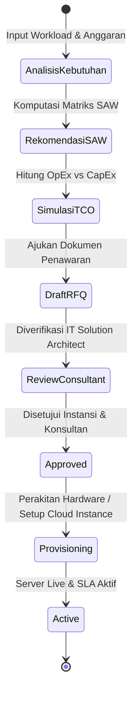
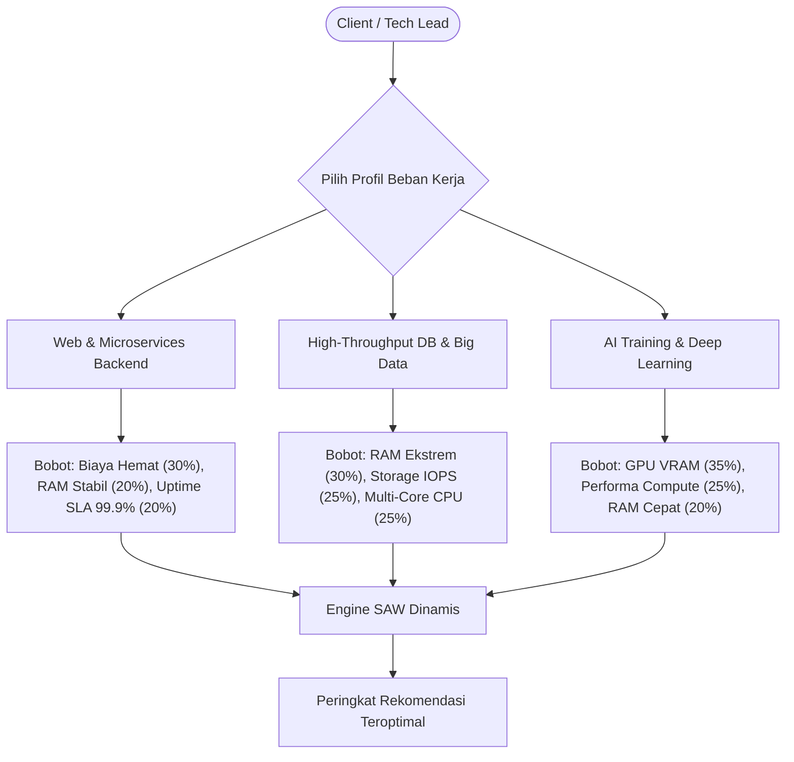
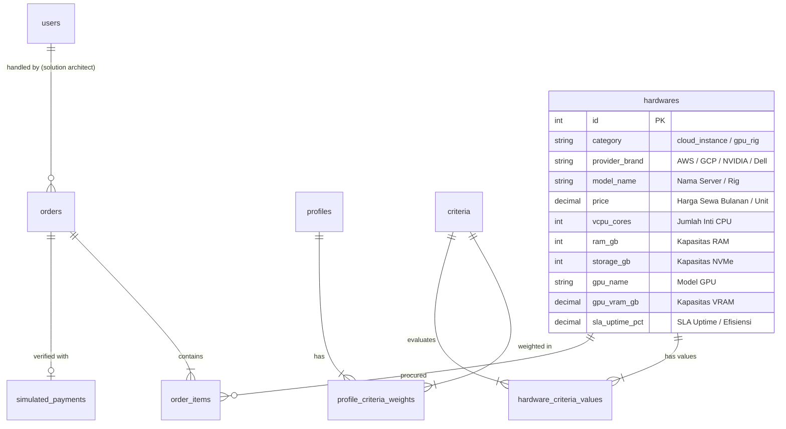
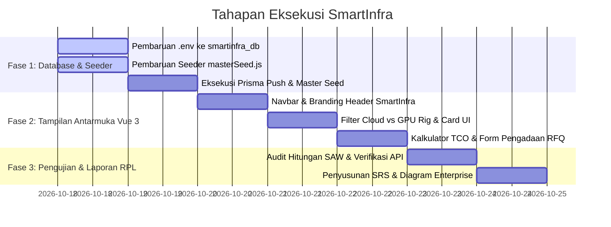

# Rancangan Lengkap Arsitektur Sistem SmartInfra
> **Sistem Pendukung Keputusan Pemilihan & Pengadaan Infrastruktur Komputasi (Cloud Server & Dedicated AI GPU Rig) Berbasis Web Menggunakan Metode Simple Additive Weighting (SAW)**  
> *Studi Kasus: Konsultan Infrastruktur TI & B2B Software House*  
> *Program Studi Teknik Informatika / Sistem Informasi — Universitas Pamulang (UNPAM)*

---

## 1. Latar Belakang & Identitas Sistem

### 1.1 Permasalahan Bisnis (Problem Domain)
Di industri teknologi modern, perusahaan software house, startup digital, maupun laboratorium riset kampus menghadapi ledakan kebutuhan komputasi untuk menjalankan dua kategori beban kerja:
1. **Layanan Aplikasi & Basis Data Tradisional**: Web API, sistem transaksi, *microservices*, dan penyimpanan data skala tinggi.
2. **Kecerdasan Buatan (Artificial Intelligence)**: *Large Language Model (LLM) fine-tuning*, *Computer Vision*, dan komputasi grafis berperforma tinggi (*High-Performance Computing / HPC*).

Tantangan utama yang dihadapi oleh *Tech Lead* dan *Chief Technology Officer (CTO)* adalah dilema **"Build vs Rent"** (Membeli vs Menyewa) serta analisis **Total Cost of Ownership (TCO)**:
- **Cloud Computing (OpEx - Operational Expenditure)**: Fleksibel dan cepat aktif, namun biaya sewa bulanan membengkak seiring tingginya *traffic* dan jam operasional.
- **On-Premise Dedicated GPU Rig (CapEx - Capital Expenditure)**: Membutuhkan biaya investasi unit awal yang besar, namun memberikan kepemilikan aset, privasi data penuh, dan biaya operasional jangka panjang yang jauh lebih hemat.

### 1.2 Solusi yang Dihadirkan: SmartInfra
**SmartInfra** adalah portal konsultasi arsitektur dan pengadaan infrastruktur TI B2B yang mengintegrasikan:
- **Mesin Rekomendasi SAW Multi-Kriteria**: Menghitung bobot teknis (*vCPU, RAM, Storage IOPS, GPU VRAM, dan Uptime SLA*) serta pagu anggaran secara matematis dan objektif.
- **Kalkulator Biaya TCO (OpEx vs CapEx)**: Menghitung estimasi biaya sewa bulanan dan harian Cloud vs simulasi angsuran/investasi hardware GPU.
- **Modul Pengadaan B2B (Request for Quotation - RFQ)**: Memfasilitasi penerbitan dokumen penawaran resmi, spesifikasi SLA digital, dan pelacakan status instalasi (*provisioning*) server.

---

## 2. Batasan Masalah & Lingkup Sistem (Scope & Limitations)

Untuk menjaga fokus dan kelayakan implementasi pada matkul Rekayasa Perangkat Lunak (RPL):

1. **Model Pengadaan B2B**: Sistem tidak beroperasi sebagai toko ritel konsumen, melainkan sebagai portal pengadaan instansi dengan alur pengajuan penawaran resmi (*Request for Quotation / RFQ*).
2. **Data-Driven & Kurasi Administrator**:
   - Pembaruan spesifikasi dan harga paket Cloud maupun hardware GPU dikelola langsung oleh **Administrator / Sysadmin** melalui modul *Master Data Management*.
   - Sistem **tidak** melakukan *scraping* otomatis atau sinkronisasi API *live-billing* ke AWS/GCP secara *real-time* pada fase ini; hal ini ditempatkan sebagai saran pengembangan lanjutan (*future work*).
3. **Simulasi Transaksi & Pelacakan**: Alur pembayaran dan penagihan disimulasikan melalui nomor referensi penawaran (*Quotation Code*) dan kode verifikasi pembayaran digital.

---

## 3. Pemodelan Aktor & Peran (Role-Based Access Control)

| Peran (Role) | Representasi Stakeholder | Tugas & Wewenang Utama dalam Sistem |
|---|---|---|
| **Client / Tech Lead** | Calon Klien Instansi / Tim Pengembang | - Melakukan simulasi kebutuhan beban kerja komputasi proyek. - Mengeksplorasi katalog Cloud Server dan Hardware GPU. - Melakukan analisis estimasi biaya TCO (OpEx vs CapEx). - Mengajukan *Request for Quotation (RFQ)* dan memantau status *provisioning*. |
| **IT Solution Architect** | Konsultan Solusi TI (Staf Sales Khusus) | - Mendampingi klien instansi dalam sesi konsultasi arsitektur infrastruktur. - Menyesuaikan skema tenor sewa / angsuran pengadaan perangkat. - Membuat pesanan penawaran atas nama klien (*Assisted Quotation*). - Memverifikasi kelayakan teknis pengajuan klien. |
| **Infrastructure Lead / Sysadmin** | Administrator Sistem Utama | - Mengelola master data infrastruktur (tambah, edit, nonaktifkan varian Cloud & GPU). - Menyesuaikan bobot kriteria SAW ($C_1 - C_6$) sesuai perubahan tren pasar. - Mengaudit matriks keputusan matematis ($X, R, V$). - Memperbarui status *provisioning* server hingga berstatus aktif (*Live*). |

---

## 4. Alur Proses Bisnis & Siklus Pengadaan (B2B Procurement Lifecycle)

---

## 5. Pemodelan Matematis Algoritma SAW

### 5.1 Penetapan Kriteria ($C_1 - C_6$)

| Kode | Nama Kriteria | Kategori | Satuan / Parameter | Bobot Default |
|:---:|---|:---:|---|:---:|
| **$C_1$** | Biaya Investasi / Sewa Bulanan | **Cost** (Minimasi) | Rupiah / Bulan (Rp) | 15% – 30% |
| **$C_2$** | Performa Processor (CPU) | **Benefit** (Maksimasi) | Jumlah vCPU / Skor Benchmark | 15% – 25% |
| **$C_3$** | Kapasitas Memori (RAM) | **Benefit** (Maksimasi) | Gigabyte (GB) DDR5 / ECC | 15% – 25% |
| **$C_4$** | Kecepatan & Kapasitas Storage | **Benefit** (Maksimasi) | Kapasitas NVMe (GB) & IOPS | 10% – 20% |
| **$C_5$** | Kapasitas AI & GPU VRAM | **Benefit** (Maksimasi) | VRAM (GB) & Skor Tensor Core | 10% – 35% |
| **$C_6$** | Keandalan & Efisiensi Daya | **Benefit** (Maksimasi) | Uptime SLA (%) / Power Index | 5% – 15% |

### 5.2 Tiga Profil Beban Kerja Proyek (*Workload Profiles*)

### 5.3 Normalisasi Dinamis & Adaptif Terhadap Masa Depan
$$
r_{ij} = \begin{cases} 
\dfrac{x_{ij}}{\max_i (x_{ij})}, & \text{jika atribut benefit} \\[10pt]
\dfrac{\min_i (x_{ij})}{x_{ij}}, & \text{jika atribut cost}
\end{cases}
$$
> [!TIP]
> **Skalabilitas Masa Depan**: Nilai pembagi $\max(x_j)$ dan $\min(x_j)$ dihitung secara dinamis dari produk yang aktif di database. Jika di masa depan dirilis GPU baru dengan spesifikasi 2x lipat lebih tinggi, formula otomatis menyesuaikan tanpa perlu mengubah kode program.

### 5.4 Nilai Preferensi Akhir ($V$)
$$
V_i = \sum_{j=1}^{n} w_j \cdot r_{ij}
$$

---

## 6. Master Data Alternatif Infrastruktur Komputasi

### Kategori A: Cloud Server Instances (Virtual / IaaS)
1. **AWS EC2 t4g.2xlarge**: 8 vCPU Graviton, 32 GB RAM, 300 GB NVMe, SLA 99.99% *(Ideal untuk Backend Web)*.
2. **Google Cloud n2-standard-16**: 16 vCPU Intel, 64 GB RAM, 500 GB NVMe, SLA 99.99% *(Ideal untuk Microservices)*.
3. **DigitalOcean Dedicated CPU Droplet**: 8 Dedicated vCPU, 32 GB RAM, 250 GB NVMe, SLA 99.95% *(Ramah Biaya Startup)*.
4. **AWS EC2 g5.2xlarge GPU Cloud**: 8 vCPU, 32 GB RAM, 24 GB VRAM NVIDIA A10G, SLA 99.95% *(Cloud AI Inference)*.
5. **Azure D16s v5 Virtual Machine**: 16 vCPU, 64 GB RAM, 400 GB Premium SSD, SLA 99.99% *(Enterprise Business Apps)*.

### Kategori B: Dedicated AI GPU Hardware Rig (On-Premise Workstation)
1. **Dual NVIDIA RTX 4090 AI Dev Rig**: AMD Threadripper 24-Core, 128 GB DDR5, 2 TB NVMe Gen4, 48 GB Total VRAM (Dual GPU), PSU 1600W *(Pilihan Utama AI Lab)*.
2. **NVIDIA RTX A6000 Ada Generation Workstation**: Intel Xeon W9 36-Core, 256 GB ECC RAM, 4 TB Enterprise NVMe, 48 GB VRAM ECC, ISV Certified *(Enterprise Deep Learning)*.
3. **NVIDIA H100 PCIe AI SuperServer**: Dual AMD EPYC 64-Core, 512 GB ECC DDR5, 8 TB NVMe U.2, 80 GB HBM3 High-Bandwidth VRAM *(LLM Pretraining Tier)*.
4. **Apple Mac Studio M2 Ultra Rig**: 24-Core CPU, 192 GB Unified Memory, 2 TB SSD, Ultra-Low Power Consumption *(Local LLM Inference)*.
5. **Dell PowerEdge R750xa GPU Server**: Dual Intel Xeon Platinum, 128 GB ECC RAM, 4 TB SAS/NVMe, Dual NVIDIA L40S GPU *(Hybrid Data Center)*.

---

## 7. Arsitektur Basis Data (`smartinfra_db`)

---

## 8. Roadmap Rencana Eksekusi Bertahap

---

## 9. Penegasan Menghadapi Sidang Penguji

> [!NOTE]
> **Mengapa B2B Procurement, Bukan Toko Ritel?**  
> Agar sistem memiliki siklus proses bisnis utuh (*Request for Quotation $\rightarrow$ Verification $\rightarrow$ Provisioning $\rightarrow$ Active SLA*) yang menjadi standar penilaian utama mata kuliah Rekayasa Perangkat Lunak.

> [!IMPORTANT]
> **Bagaimana Menjawab Dosen Mengenai Relevansi Masa Depan?**  
> Sistem dirancang *Data-Driven*. Pembagi normalisasi $\max(x_j)$ dan $\min(x_j)$ bersifat dinamis. Ketika produk baru dirilis oleh provider di tahun mendatang, admin cukup menambahkannya lewat panel Master Data tanpa perlu memprogram ulang rumus.
